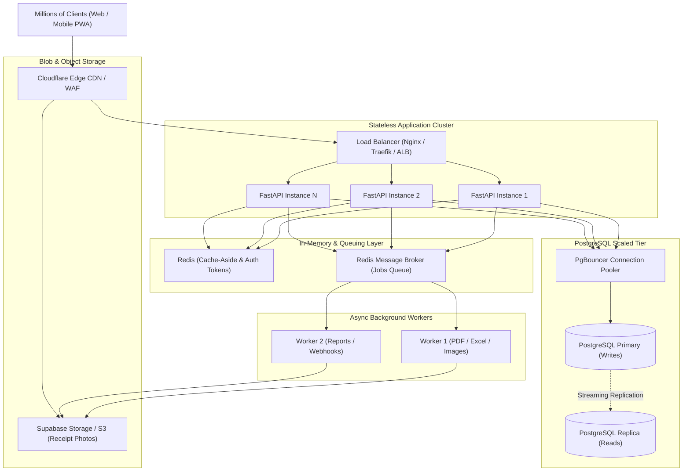
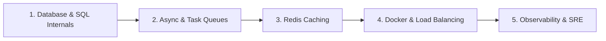

# High-Scale System Design & Developer Learning Roadmap

---

## Part 1: High-Scale Architecture (Millions of Users)

When a web application scales from hundreds to millions of users, crashes almost never happen at the web framework level (FastAPI or Next.js). They hit three predictable bottlenecks: **database connection pool exhaustion**, **blocking CPU execution in the async event loop**, and **unindexed/uncached database queries**.

### Target Architecture

---

### The 6 Core Pillars

#### 1. Database Connection Pooling & Indexing
- **The Problem:** Each direct PostgreSQL connection spawns a backend OS process using ~10 MB of RAM. Direct connections fail under heavy concurrency (`FATAL: remaining connection slots are reserved`).
- **Solution:** 
  - Deploy **PgBouncer** in transaction pooling mode. Maintain 20–50 persistent physical connections to handle thousands of concurrent virtual clients.
  - **Composite Indexes:** In multi-tenant systems, never index columns in isolation. Create composite B-tree indexes: `CREATE INDEX ix_records_company_date ON records (company_id, record_date DESC);`.
  - **Read/Write Splitting:** Route write operations (`INSERT`, `UPDATE`, `DELETE`) to the Primary DB, and heavy reporting/listing queries to Read Replicas.

#### 2. In-Memory Caching (Redis)
- **Pattern:** Cache-Aside.
- **Rules:**
  1. Check Redis for `company:{id}:lookups`.
  2. On **Cache Hit**: return JSON immediately (< 1 ms latency).
  3. On **Cache Miss**: query PostgreSQL, populate Redis with TTL (e.g., 3600 seconds).
  4. Invalidate (delete) the Redis key immediately whenever an admin updates project codes, categories, or expense centers.

#### 3. Asynchronous Worker Queues (Celery / ARQ)
- **The Problem:** Heavy synchronous work (ReportLab PDF generation, openpyxl Excel streaming, image resizing) freezes CPU threads.
- **Solution:** Endpoints must be non-blocking. Heavy tasks return `202 Accepted` with a `task_id` within 10 ms. A dedicated background worker executes the task, stores the file in object storage, and notifies the client.

#### 4. Stateless Horizontal Scaling
- FastAPI instances must not store state in local container memory or local disk.
- Containerize using Docker and scale horizontally behind a reverse proxy (Nginx or Traefik) across multiple instances.

#### 5. Storage Optimization & Edge CDN
- Never serve raw full-resolution receipt images through the Python application.
- Put a CDN (e.g., Cloudflare) in front of Supabase Storage to cache images at edge nodes globally.
- Generate and store lightweight thumbnails (200px width, ~15 KB) on upload for dashboard table previews.

#### 6. Resilience & Observability
- **Rate Limiting:** Enforce limits using `slowapi` or Cloudflare WAF against credential stuffing and brute-force attacks.
- **Telemetry:** Integrate **Sentry** for real-time error tracking and **Prometheus + Grafana** for latency percentiles ($P95$ and $P99$).

---

## Part 2: Step-by-Step Learning Roadmap

To build intuition without getting overwhelmed by abstract theory, follow this 5-stage progression. Start with concrete code optimizations on your current project, then expand outward to infrastructure.

### Stage 1: Database Internals & Query Tuning (Start Here)
*Why start here:* 90% of scaling problems occur at the database.

- **Key Topics:**
  - `EXPLAIN (ANALYZE, BUFFERS)`: Understanding Seq Scan vs. Index Scan vs. Bitmap Heap Scan.
  - Multi-column (Composite) B-Tree indexing rules (Leftmost Prefix rule).
  - PostgreSQL connection lifecycles and why direct connections exhaust server memory.
  - Database migrations with Alembic (writing non-locking migrations for large tables).
- **Hands-on practice on your current project:**
  - Run `EXPLAIN ANALYZE` on your `_apply_record_filters` query with simulated volume.
  - Inspect indexing on foreign keys (`company_id`, `created_by_id`, `category_id`).

### Stage 2: Asynchronous Execution & Task Queues
*Why:* Learn how to decouple fast HTTP requests from slow CPU/IO tasks.

- **Key Topics:**
  - Python `asyncio` event loop: Why running a synchronous function (like `openpyxl.save()`) inside `async def` freezes your entire server.
  - `def` vs `async def` routing inside FastAPI (threadpool execution vs event loop).
  - Background workers using **ARQ** (lightweight async Redis queue) or **Celery**.
- **Hands-on practice on your current project:**
  - Move the Excel or PDF export generator out of the main request cycle into a background worker job.

### Stage 3: In-Memory Caching & State Management (Redis)
*Why:* Reduces database read loads by 70–80%.

- **Key Topics:**
  - The **Cache-Aside** pattern.
  - Cache Invalidation strategies (time-based TTL vs event-driven purge).
  - Atomic operations and distributed locks (`SETNX`).
- **Hands-on practice on your current project:**
  - Cache the response of `/api/v1/lookups/project-codes` and `/expense-centers` in Redis. Invalidate the key when a new project code is added.

### Stage 4: Containerization & Horizontal Scaling
*Why:* Learn how multiple copies of your backend coordinate seamlessly.

- **Key Topics:**
  - Production multi-stage `Dockerfile` (optimizing layer caching and binary sizes).
  - Docker Compose for full multi-container orchestration (`app`, `db`, `redis`, `worker`).
  - Reverse proxying and load balancing using **Nginx** or **Caddy** (round-robin routing, SSL termination).
- **Hands-on practice on your current project:**
  - Run 2 instances of your FastAPI container behind an Nginx load balancer locally and verify requests distribute evenly.

### Stage 5: Production Observability & Hardening
*Why:* You cannot scale what you cannot measure.

- **Key Topics:**
  - Rate limiting using `slowapi` (token bucket / sliding window algorithms).
  - Application metrics: Tracking latency ($P50$, $P95$, $P99$) and error rates with Prometheus.
  - Centralized error tracking and alerting with **Sentry**.
- **Hands-on practice on your current project:**
  - Add rate limiting (e.g., maximum 5 login attempts per minute per IP) on `/api/v1/auth/login`.

---

### Recommended Reference Reading

1. **Books:**
   - *Designing Data-Intensive Applications* by Martin Kleppmann (The gold standard for distributed systems and databases).
   - *High Performance PostgreSQL for Rails/Python Devs* or PostgreSQL Official Documentation on Indexing.
2. **Interactive Tools:**
   - [Use The Index, Luke!](https://use-the-index-luke.com/) (Best free interactive guide to SQL indexing).
   - [PGAnalyze Indexing Guide](https://pganalyze.com/docs) (Real-world Postgres performance analysis).
